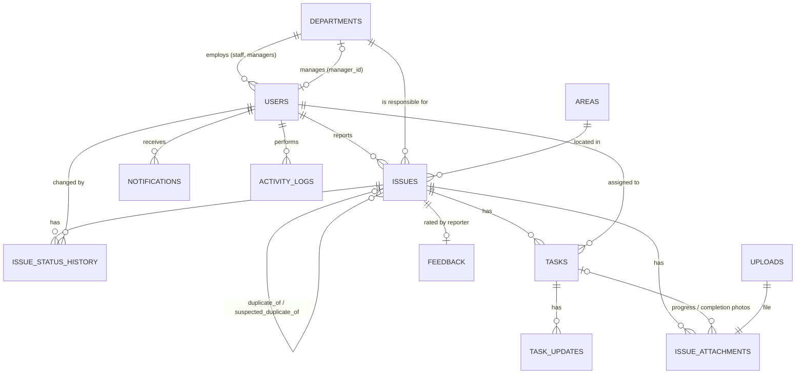

# Database design

PostgreSQL, managed with Drizzle ORM. Source of truth: [`src/db/schema.ts`](../src/db/schema.ts). Migrations: [`drizzle/`](../drizzle).

## Entity relationship diagram

## Enums

| Enum | Values |
| --- | --- |
| `user_role` | ADMIN, DEPT_MANAGER, STAFF, CITIZEN |
| `issue_status` | SUBMITTED, UNDER_REVIEW, ASSIGNED, IN_PROGRESS, RESOLVED, CLOSED, REJECTED |
| `issue_category` | ROAD_DAMAGE, STREETLIGHT, DRAINAGE, FOOTPATH, WASTE_MANAGEMENT, PUBLIC_INFRASTRUCTURE |
| `issue_priority` | LOW, MEDIUM, HIGH, CRITICAL |
| `task_status` | ASSIGNED, IN_PROGRESS, COMPLETED (awaiting review), APPROVED, REWORK, CANCELLED |
| `task_update_type` | PROGRESS, NOTE, STATUS, REVIEW |
| `attachment_kind` | REPORT, PROGRESS, COMPLETION |
| `notification_type` | ISSUE_STATUS, TASK_ASSIGNED, TASK_UPDATE, TASK_REVIEW, REMINDER, FEEDBACK, SYSTEM |

## Tables

### `users`
| Column | Type | Notes |
| --- | --- | --- |
| id | uuid PK | |
| name, email | varchar | unique index on `lower(email)` |
| password_hash | text | bcrypt |
| role | user_role | default CITIZEN, indexed |
| department_id | uuid → departments | required for STAFF / DEPT_MANAGER (enforced in service layer) |
| permissions | text[] | extra admin-granted permissions on top of role defaults |
| is_active | boolean | deactivated users cannot sign in |
| session_version | int | bumped to revoke sessions |
| phone, address, avatar_url, job_title, last_login_at, created_at, updated_at | | |

### `departments`
| Column | Type | Notes |
| --- | --- | --- |
| id | uuid PK | |
| name, code | varchar | both unique |
| categories | issue_category[] | auto-routing of new reports |
| manager_id | uuid → users | |
| is_active | boolean | cannot deactivate with open issues |
| description, email, phone, timestamps | | |

### `areas` (sample locations)
`id, name (unique), zone, ward, latitude, longitude`. 36 areas in 5 zones. New issues snap to the nearest area within 4 km.

### `issues`
| Column | Type | Notes |
| --- | --- | --- |
| id | uuid PK | |
| reference_code | varchar unique | `CP-YYYY-NNNNN` from sequence `issue_ref_seq` |
| title, description | | |
| category | issue_category | indexed |
| priority | issue_priority null | set on verification |
| status | issue_status | indexed |
| address | varchar | |
| latitude, longitude | double | `CHECK` range constraints, composite index for bounding-box queries |
| area_id | → areas | |
| reporter_id | → users | `ON DELETE RESTRICT` (history must survive) |
| department_id | → departments | |
| duplicate_of_id | → issues | confirmed duplicate |
| suspected_duplicate_of_id | → issues | set automatically on submission |
| verified_by_id, verified_at | | |
| due_at | timestamptz | verified_at + SLA days for the priority |
| resolved_at, closed_at, rejection_reason | | |
| created_at, updated_at | | indexed `created_at` for date filtering and trends |

### `issue_status_history` (append-only audit trail)
`id, issue_id, from_status, to_status, changed_by_id, note, created_at`. Written by one function (`applyTransition`) for every status change, inside the same transaction; never updated or deleted by the app. Index `(issue_id, created_at)`.

### `tasks`
`id, issue_id, assignee_id (STAFF, same department), assigned_by_id, status, instructions, progress (0–100 CHECK), due_date, started_at, completed_at, reviewed_at, reviewed_by_id, review_note, last_reminder_at, timestamps`. Reassignment cancels the previous active task, so an issue keeps its full task history. Index `(assignee_id, status)`.

### `task_updates`
`id, task_id, author_id, type, message, progress, created_at` — progress reports, notes, status and review entries.

### `uploads` / `issue_attachments`
`uploads` stores image bytes (`bytea`), sniffed MIME type, size and owner. `issue_attachments` links an upload to an issue (and optionally a task) with a kind (REPORT / PROGRESS / COMPLETION). An upload can be attached only once, and only by its owner.

### `feedback`
`id, issue_id (unique), citizen_id, rating (1–5 CHECK), comment, created_at`.

### `notifications`
`id, user_id, type, title, message, link, is_read, created_at`. Index `(user_id, is_read, created_at)` serves the bell count, list and SSE stream.

### `activity_logs`
`id, actor_id, action, entity_type, entity_id, summary, metadata jsonb, created_at` — system-wide activity history (issue edits, assignments, user and department changes, settings).

### `system_settings`
Key/value (`jsonb`) configuration: city name, map centre, GPS bounds, duplicate radius, SLA days, reminder interval, registration and routing switches.

## Key rules encoded in data access

| Rule | Where |
| --- | --- |
| Allowed status transitions | `TRANSITIONS` in `src/server/services/issues.ts` |
| Optimistic locking on status updates | `UPDATE … WHERE id = ? AND status = ?` + `SELECT … FOR UPDATE` |
| Role scoping of issue queries | `issueScope(user)` (citizen: own; staff: assigned; manager: department; admin: all) |
| Duplicate detection | bounding-box query on `(latitude, longitude)` → haversine distance + text similarity |
| Analytics | SQL aggregates with `FILTER` clauses, `generate_series` for monthly trends |
